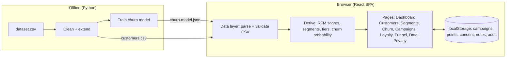

# RetailMax CRM — Streamlining Customer Relationships

HCLTech Career Shaper Programme · III Year Industry Project · Project No. 27 · Domain: Digital-Data-AI / AIML

A CRM for a retail business with **RFM customer segmentation**, **machine-learning churn prediction**,
**campaign management**, a **loyalty points programme**, **sales funnel analytics** and a
**DPDP Act 2023 consent and privacy console**. It runs fully in the browser on the provided
`dataset.csv`; a Python pipeline cleans the data, extends it to 5,000 rows and trains the churn model.

## Modules

| Route | Module | What it does |
|---|---|---|
| `/` | Dashboard | KPIs (revenue, AOV, churn rate, active customers, consent share), segment, region, recency and tier charts, top customers, customers needing attention |
| `/funnel` | Sales Funnel | Customer lifecycle funnel (all → repeat → regular → frequent → high value → retained) with filters, region breakdown and campaign funnel |
| `/customers` | Customers | Search, filter (segment, region, age, tier, risk, consent), sort, paginate, export CSV |
| `/customers/:id` | Customer 360 | Value, RFM scores, churn probability with per-feature explanation, next best action, points, consent, notes, timeline |
| `/segments` | RFM Segments | Quintile RFM scoring, 5 segments with strategy, R×F heatmap, dataset-label vs computed agreement |
| `/churn` | Churn Prediction | Model card (accuracy, precision, recall, F1, ROC-AUC, confusion matrix, LR vs Random Forest), risk list, what-if simulator |
| `/campaigns` | Campaigns | 3-step wizard, live audience with consent gate, schedule/launch, simulated delivery → conversion results |
| `/loyalty` | Loyalty | Tier rules, points liability, near-next-tier nudges, bulk awards, transaction ledger |
| `/data` | Data Import / Export | Validated CSV upload (merge or replace), full and enriched export, data-quality summary |
| `/privacy` | Privacy & Consent | Consent register, consent and audit logs, right to erasure |

## Run it

```bash
npm install
npm run dev        # http://localhost:5190
npm run build      # type-check + production build into dist/
npm run preview    # serve the build on http://localhost:5191
```

Requires Node.js 20 or newer. No database, server or API key is needed: the dataset is bundled from
`src/data/customers.csv`, the trained model from `src/data/churn-model.json`, and every change you
make in the demo (campaigns, points, consent, notes, imports) is kept in the browser's localStorage.
"Reset demo" in the top bar clears it.

## Data and machine-learning pipeline (Python)

See [`analysis/README.md`](analysis/README.md).

```
data/dataset_original.csv  (500 rows from HCL)
        │  analysis/generate_dataset.py   +4,500 synthetic rows, ~15% churn, ~3% labelled faults
        ▼
data/dataset_raw_combined.csv
        │  analysis/clean_dataset.py      duplicates, missing and out-of-range values
        ▼
data/dataset.csv  ──copy──▶ src/data/customers.csv
        │  analysis/train_churn_model.py  Logistic Regression + Random Forest (scikit-learn)
        ▼
src/data/churn-model.json  (coefficients + metrics, scored in the browser)
```

`analysis/eda.ipynb` holds the exploratory analysis with its charts; the charts are also saved in
`docs/figures/`.

## Architecture



Stack: React 19, TypeScript, Vite, Tailwind CSS, shadcn/ui (Radix), Recharts, React Router ·
Python, pandas, scikit-learn, matplotlib, seaborn, Jupyter.

## RFM method

Recency = `last_purchase_days` (lower is better), Frequency = `purchase_freq`,
Monetary = `purchase_freq × avg_order_value`. Each is scored 1–5 by quintile; the segment comes from
R and F:

| Rule | Segment |
|---|---|
| R ≥ 4 and F ≥ 4 | Champion |
| R ≥ 3 and F ≥ 3 | Loyal |
| R ≥ 4 and F ≤ 2 | New |
| R ≤ 2 and F ≥ 3, or R = 3 and F ≤ 2 | At Risk |
| R ≤ 2 and F ≤ 2 | Lost |

## Ethics and DPDP Act 2023

- Customers are identified only by anonymised IDs (`C00001`); no names, phone numbers or emails exist in the data.
- Campaigns reach only customers with marketing consent; the wizard shows how many were excluded.
- Every consent change and every erasure is logged; the Privacy console supports the right to erasure.
- AI assistance (Claude) was used to build this project and is disclosed in the report appendix.

## Project documents

- [`docs/PROJECT_REPORT.md`](docs/PROJECT_REPORT.md) — project report
- [`docs/SYNOPSIS.md`](docs/SYNOPSIS.md) — filled synopsis template
- [`data/data_dictionary.csv`](data/data_dictionary.csv) — column descriptions
- [`docs/DEMO_SCRIPT.md`](docs/DEMO_SCRIPT.md) — 1 min 50 s demo recording script
- [`docs/figures/app/`](docs/figures/app/) — 25 screenshots of the live app
- `docs/build/` — scripts that build the Word report, the filled synopsis and the ethics declaration
  into `submission/` (for example `python docs/build/build_report_docx.py`; needs `python-docx`)
- The original HCL brief and synopsis template are kept out of this public repository.
