# RetailMax CRM: Streamlining Customer Relationships

**HCLTech Career Shaper Programme | III Year Industry Project | Academic Year 2025-26**

| Field | Details |
|---|---|
| Project title | RetailMax CRM: Streamlining Customer Relationships |
| Project No. | 27 |
| Domain | Digital-Data-AI / AIML |
| Difficulty / duration | Intermediate / 4 weeks |
| Format | Individual project (1 learner) |
| Learner name | [FILL IN] |
| Roll number | [FILL IN] |
| College / campus | [FILL IN] |
| Mentor name | [FILL IN] |
| Submission date | [FILL IN] |

---

## Contents

1. Abstract
2. Introduction and problem statement
3. Objectives
4. Literature and industry context
5. Dataset and the no-signal finding
6. Data generation and cleaning
7. RFM method
8. Churn prediction model
9. System architecture
10. Module descriptions
11. Testing approach
12. Results
13. Challenges and resolutions
14. Ethics and DPDP Act 2023 compliance
15. Limitations and future scope
16. References
- Appendix A: AI tools disclosure
- Appendix B: How to rerun the pipeline
- Appendix C: Deliverables checklist

---

## 1. Abstract

RetailMax CRM is a customer relationship management prototype for a retail business. It groups customers into five segments (Champion, Loyal, New, At_Risk, Lost) with the RFM method, estimates how likely each customer is to stop buying, lets a marketing team build campaigns that reach only customers who have agreed to be contacted, tracks loyalty points and tiers, and shows a lifecycle sales funnel. The application is a React 19 and TypeScript single-page app that runs entirely in the browser. It has no server database: customer data is a CSV file that ships with the app, and everything the user changes (consent, points, notes, campaigns) is saved in the browser's localStorage.

The data science half of the project is an offline Python pipeline (pandas and scikit-learn). It prepares the dataset, trains a logistic regression churn model, and exports the model as a small JSON file that the app evaluates in the browser. The pipeline also produces the exploratory analysis notebook, the cleaned dataset and the data dictionary.

The most important finding came during exploratory analysis. The 500-row file supplied by HCL is statistically random. Churn is between 13.7% and 20.0% in every given segment, and the average time since the last purchase is between 182 and 203 days in every segment. Customers labelled Champion are no more recent than customers labelled Lost. The segment labels agree with the standard RFM rule on 19.4% of rows, which is what random labels produce. A model trained on those 500 rows alone scores a ROC-AUC of 0.475, which is chance. HCL's brief allows extra rows to be generated, so 4,500 rows with realistic, correlated patterns were generated, mixed with the 500 original rows, faults were injected and then cleaned, giving 4,961 rows with a 15.14% churn rate.

On a held-out test set of 993 customers the logistic regression reaches accuracy 0.759, precision 0.356, recall 0.733, F1 0.479 and ROC-AUC 0.813. The random forest comparison model reaches ROC-AUC 0.794. These numbers describe how well the pipeline recovers patterns that were built into the generated data. They are not a claim about churn at a real retailer, and the report says so wherever it matters.

**Keywords:** CRM, RFM segmentation, churn prediction, logistic regression, loyalty programme, DPDP Act 2023, React, scikit-learn.

---

## 2. Introduction and problem statement

A retailer with thousands of customers cannot treat them all the same. Some buy every month and spend a lot. Some bought once and never came back. A few are drifting away, and the business learns about it only when the revenue is gone. A CRM system keeps one record per customer and turns purchase history into decisions: who to reward, who to win back, who to leave alone.

### 2.1 Problem statement (5W1H)

| Question | Answer |
|---|---|
| **Who** faces the problem? | Marketing and sales managers at a retail business with customers across several regions. The brief calls the case RetailMax. Store managers and customer service staff feel the effects too. |
| **What** is the problem? | Customers are managed through spreadsheets and treated alike. There is no shared view of who is valuable, who is slipping away, and who has agreed to receive marketing. Campaigns go to everyone, loyalty points are tracked by hand, and churn is noticed only after the customer has gone. |
| **When / where** does it occur? | In every campaign cycle and every region. Churn in retail is silent: the signal is a customer who stops buying for months, and nobody is watching for it. |
| **Why** does it matter? | Keeping a customer is generally cheaper than winning a new one, so late detection of churn wastes money. Sending marketing without consent is also a legal risk under India's Digital Personal Data Protection Act, 2023. |
| **How** is it solved here? | RFM segmentation groups customers by recency, frequency and spend. A logistic regression gives each customer a churn risk. A campaign builder targets segments, regions, age groups and risk bands, and contacts only customers with consent. Loyalty and funnel screens complete the view. A Python pipeline prepares the data and the model; a React app delivers the screens. |

### 2.2 Scope

In scope: the nine screens listed in section 10, the offline data and model pipeline, the dataset and its documentation, and the compliance features (consent gate, consent log, erasure).

Out of scope: a server, a database, user accounts and login, real message sending (campaign results are simulated and the screen says so), payment handling, and integration with a point-of-sale system.

### 2.3 A note on the tools in the brief

The brief lists "Python, Django, PostgreSQL, Pandas, Scikit-learn, Tableau" under Tools and Libraries. This project uses Python, pandas and scikit-learn for the data science work, and a React single-page app with CSV and localStorage in place of Django and PostgreSQL. The reasons: the project is individual and runs four weeks, the demo must run on a laptop with nothing to host, and a browser-only design means customer data never leaves the user's machine, which is the safest default for a privacy-sensitive prototype. The cost is real and stated in section 15: one browser holds one copy of the state, there are no user accounts, and nothing is shared between users.

---

## 3. Objectives

1. Segment customers with RFM and show segment sizes, value and churn.
2. Predict churn risk per customer with a model that can be explained and that runs in the browser.
3. Build and target campaigns only at customers with marketing consent.
4. Track loyalty points and tiers with a ledger of every adjustment.
5. Show a sales funnel that follows the customer lifecycle.
6. Let the user import and export customer data as CSV with validation.
7. Meet the ethics requirements in the brief: anonymised data, consent before marketing, DPDP Act 2023.
8. Deliver a cleaned dataset, a data dictionary and an EDA notebook with at least three visualisations (this project has eleven).
9. Measure the model against the criteria the brief asks for and report the numbers without rounding them up.

---

## 4. Literature and industry context

### 4.1 RFM segmentation

RFM scores customers on three behaviours: Recency (how long since the last purchase), Frequency (how often they buy) and Monetary value (how much they spend). The idea is usually credited to direct-marketing practice and was set out in Arthur Hughes' *Strategic Database Marketing* (1994), which popularised ranking customers on these three measures and splitting each into five groups. Its appeal is that it needs only a transaction history and gives marketers an immediate, explainable ranking. Fader, Hardie and Lee (2005) examined why RFM works and showed how it relates to customer lifetime value models. Chen, Sain and Guo (2012) applied RFM-based segmentation to an online retailer's data. This project uses the quintile (five-group) version.

### 4.2 Churn prediction

Churn prediction treats "will this customer stop buying" as a classification problem. Neslin et al. (2006) compared many methods for predicting customer defection and found that the choice of method matters less than the quality of the data and how the model is evaluated. Verbeke et al. (2011) stressed that a churn model has to be understandable to the people who act on it, which favours simple models such as logistic regression over opaque ones. Churn data is also imbalanced, because most customers stay. He and Garcia (2009) survey the techniques for this; this project uses class weighting. Reichheld and Sasser (1990) made the business case that small gains in retention have a large effect on profit, which is why churn is worth predicting.

### 4.3 What commercial CRM systems offer

Products such as Salesforce Sales Cloud and HubSpot CRM keep one record per contact, track deals through a pipeline, run email and marketing campaigns, report on results, and offer lead or contact scoring and consent or subscription settings. Salesforce also sells loyalty programme management. The features in this project follow the same shape on a smaller scale: a customer record with a 360-degree view, a funnel, a campaign builder, a loyalty ledger and consent management. What a prototype cannot match is scale, integrations, user management and audit-grade storage. Section 15 lists those gaps.

### 4.4 Data protection

India's Digital Personal Data Protection Act, 2023 requires a data fiduciary (here, the retailer) to process personal data only with valid consent or for specified legitimate uses, to give notice of the purpose, to let the data principal (the customer) withdraw consent as easily as it was given, and to erase data when asked unless a law requires keeping it. Section 14 describes how these ideas appear in the app.

---

## 5. Dataset and the no-signal finding

### 5.1 The data HCL supplied

`data/dataset_original.csv` has 500 rows and nine columns: customer_id, age_group, region, purchase_freq, avg_order_value, last_purchase_days, loyalty_points, churn_flag and rfm_segment. There are no missing values and every customer_id is unique. 79 of 500 customers have churn_flag = 1, a churn rate of 15.8%. The data dictionary HCL provided has the description column left blank for the learner to fill in; the completed version is `data/data_dictionary.csv`.

| Column | Type | Range or values in HCL's file |
|---|---|---|
| customer_id | string | C00001 to C00500 |
| age_group | category | 18-25, 26-35, 36-45, 46-55, 55+ |
| region | category | North, South, East, West, Central |
| purchase_freq | int | 1 to 48 |
| avg_order_value | float (INR) | 266 to 19,904 |
| last_purchase_days | int | 1 to 365 |
| loyalty_points | int | 38 to 9,997 |
| churn_flag | int | 0 or 1 |
| rfm_segment | category | Champion, Loyal, At_Risk, Lost, New |

### 5.2 The finding: the labels carry no signal

A segment label is only useful if customers in the segment behave differently. The table shows HCL's rows grouped by the segment label HCL gave them.

| Given segment | Customers | Churn rate | Mean days since last purchase | Mean purchases |
|---|---:|---:|---:|---:|
| Champion | 117 | 13.7% | 185.4 | 23.8 |
| Loyal | 95 | 16.8% | 198.0 | 22.9 |
| New | 101 | 14.9% | 202.8 | 24.7 |
| At_Risk | 92 | 14.1% | 181.9 | 24.6 |
| Lost | 95 | 20.0% | 183.9 | 25.8 |

Every segment has about the same churn rate (13.7% to 20.0%) and about the same recency (182 to 203 days). Champions are no more recent than Lost customers (185 against 184 days). A New customer should have few purchases and a recent one; here New customers average 24.7 purchases and 203 days. The 20.0% churn for Lost is one standard deviation above the overall 15.8% (a group of 95 has a standard deviation of about 3.7 points), so it is within chance.

Four more checks point the same way:

- The correlation between churn and recency is 0.012, and between churn and frequency 0.023.
- The correlation between loyalty points and lifetime spend (purchase_freq times avg_order_value) is 0.027. A customer who spent INR 20,000 can hold 9,000 points; one who spent INR 900,000 can hold 500.
- Applying the standard RFM rule to the 500 rows gives a segment that matches HCL's label on 19.4% of rows. Random labels across five segments would match about 20%.
- A logistic regression trained and cross-validated on the 500 rows alone (5-fold, repeated 10 times) has ROC-AUC 0.475 with a standard deviation of 0.053. A coin flip is 0.5.

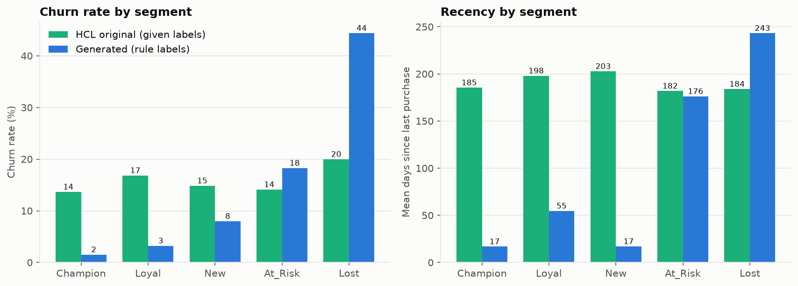

### 5.3 What this means for the project

A model trained on labels with no signal learns nothing, and a segment chart built on labels that do not follow behaviour misleads. There are three honest options: build the model anyway and report a meaningless number, replace the labels with the RFM rule's output and still have no churn signal, or add data that carries the patterns real CRM data show. HCL's brief allows the third: its dataset prompt asks for 20,000 CRM records with RFM segmentation, purchase patterns and a 15% churn rate, and suggests about 4,500 extra rows to reach 5,000. This project follows that route and keeps the 500 original rows in the final file (10% of rows) so the submission still contains HCL's data.

The consequence must be stated plainly: **the churn model's performance comes from patterns that were designed into 90% of the rows.** It shows that the pipeline works from end to end. It does not show how predictable churn is at a real retailer. With real data, the same scripts retrain the model and the app needs only the new JSON file.

---

## 6. Data generation and cleaning

### 6.1 Generation (`analysis/generate_dataset.py`)

The script creates 4,500 rows with customer ids C00501 to C05000, using a fixed seed (42), so the same file comes out every time (checked: two runs give identical files).

**Hidden customer types.** Each customer belongs to one of six hidden types. The type fixes a joint pattern of purchases, recency and order value, and is never written to the file; only its footprint is.

| Hidden type | Share | Purchases (mean) | Days since last purchase | Median order value (INR) |
|---|---:|---:|---|---:|
| champion | 16% | 34 | mostly under 30, capped at 90 | 11,000 |
| regular | 28% | 22 | mostly under 60, capped at 200 | 8,000 |
| new | 15% | 4 | mostly under 30, capped at 75 | 6,500 |
| occasional | 17% | 8 | spread over 30 to 260 | 4,500 |
| slipping | 13% | 20 | spread over 130 to 300 | 9,000 |
| lapsed | 11% | 9 | spread over 240 to 365 | 6,000 |

Order value is log-normal around the type's median and multiplied by a region factor between 0.88 (Central) and 1.08 (West). Age group and region are drawn with unequal shares (for example 30% aged 26-35, 11% aged 55+).

**Loyalty points** are about lifetime spend divided by 100 (1 point per INR 100, the rule the app uses), multiplied by random noise of roughly 25%, and capped at 9,999.

**Churn** is drawn from a logistic probability that rises with recency (coefficient 1.10 per standard deviation), falls with frequency (-0.75) and order value (-0.20), jumps by 0.60 after 250 days of silence, shifts a little with age group (18-25 higher, 55+ lower) and region, and carries random noise (standard deviation 0.90) for everything the data does not record. The intercept is found by bisection so that the average probability is 15%. The generated rows have a churn rate of 14.98%.

**Segments** are assigned with the shared RFM rule (section 7).

### 6.2 Fault injection

HCL's brief asks for anomalies to be labelled at about 2 to 5% of rows. The script injects 135 faults into the raw file, 2.7% of 5,000 rows, each in its own row, only in generated rows (HCL's 500 rows stay untouched). The labels go to `data/anomaly_labels.csv` (customer_id, fault_type, column, raw_value).

| Fault type | Column | Rows |
|---|---|---:|
| duplicate_row | all columns | 20 |
| missing_value | age_group, region, avg_order_value, loyalty_points, last_purchase_days, churn_flag | 8, 8, 10, 8, 5, 6 (45 in all) |
| negative_value | avg_order_value, loyalty_points | 12, 6 |
| out_of_range | last_purchase_days, purchase_freq, avg_order_value | 14, 8, 6 |
| format_inconsistency | region, age_group, churn_flag | 8, 6, 6 |
| invalid_category | age_group | 4 |

The raw combined file, `data/dataset_raw_combined.csv`, holds 5,020 rows: 500 original, 4,500 generated, plus the 20 duplicate copies.

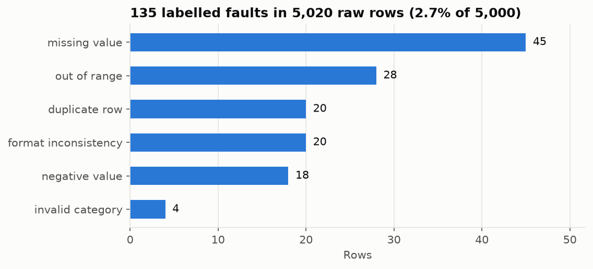

### 6.3 Cleaning (`analysis/clean_dataset.py`)

The cleaner applies thirteen numbered rules in order. A row is counted under the first rule that fires on it. The cleaner never reads the fault labels while cleaning; it reads them at the end to check what it caught. `data/cleaning_report.md` is written by the script and holds the full per-rule table.

| Rule | What is wrong | Action | Rows |
|---|---|---|---:|
| R1 | Exact duplicate rows | dropped (first copy kept) | 20 |
| R2 | Region or age_group with wrong case or padding | fixed (strip, Title Case) | 8 + 6 |
| R3 | churn_flag written as Yes/No/Y/N/true/false | fixed (mapped to 1/0) | 6 |
| R4 | Non-numeric text in a numeric column | set to missing | 0 |
| R5 | age_group or region outside the allowed list | set to missing, imputed in R12 | 4 |
| R6 | Same customer_id with different content | dropped | 0 |
| R7 | Missing customer_id or churn_flag | dropped | 6 |
| R8 | Missing last_purchase_days or purchase_freq | dropped | 5 |
| R9 | Negative avg_order_value | fixed (absolute value) | 12 |
| R10 | Negative loyalty_points | set to missing, imputed in R12 | 6 |
| R11 | Out of range: recency outside 1-365 (14), frequency outside 1-48 (8), order value outside 100-25,000 (6), points above 9,999 (0) | dropped | 28 |
| R12 | Missing age_group (12), region (8), avg_order_value (10), loyalty_points (14) | imputed: mode for categories (26-35, West), median for numbers (7,941.45; 1,349) | 44 |
| R13 | rfm_segment | recomputed with the shared RFM rule | 777 |

**Why these choices.**

- The churn label and the two inputs of the segment rule (recency and frequency) are never imputed. An invented label trains the model on made-up answers, and an invented recency moves a customer into the wrong segment.
- Order value and loyalty points are imputed with the median, categories with the mode. They do not decide the segment or the label, and the median is not pulled by outliers.
- A negative order value is read as a sign error and made positive. This is an assumption; dropping the rows is the alternative and would cost 12 more rows.
- Out-of-range values are dropped, not clipped. Clipping a recency of 900 to 365 would claim knowledge the data does not have.
- Valid ranges come from HCL's file (observed 1-48, 266-19,904, 1-365, 38-9,997) with slack on order value.

**Why the segment is recomputed (R13).** The labels in HCL's file do not follow the rule (19.4% match on the 500 rows alone). The app computes the segment with the same rule over whatever rows it loads, so the CSV now carries the same value the app shows. 777 labels changed: most of HCL's 500 rows, plus 8.1% of generated rows whose quintile cut-offs moved once HCL's rows joined the data. The original labels remain in `data/dataset_original.csv`.

**Outcome.** 5,020 rows in, 4,961 rows out (59 removed: 20 duplicates and 39 rows that could not be repaired). The cleaned file has no nulls, unique customer ids, all values in range, and a churn rate of 15.14% (751 of 4,961). The cross-check against the injected labels found that the expected rule fired on all 135 labelled faults. This check covers only faults that were labelled. A wrong value that still sits inside the valid range, such as 900 typed instead of 9,000, passes every rule; range checks cannot find those.

The cleaned file is written to `data/dataset.csv`, and a byte-identical copy goes to `src/data/customers.csv`, which the app imports.

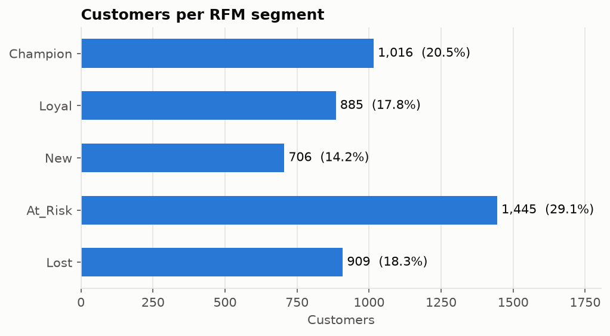

### 6.4 Data dictionary

`data/data_dictionary.csv` keeps the layout of HCL's dictionary (column_name, data_type, three sample values, nullable) and renames the last column to `description`. Types are the real ones (string, category, int, float), sample values are the first three rows of the cleaned file, and every column has a description in plain words, including the unit (INR), the range and how the column is used in RFM.

---

## 7. RFM method

### 7.1 The rule

The same rule runs in the Python pipeline and in the app (`src/lib/data/derive.ts`).

- **Recency** = last_purchase_days (lower is better). **Frequency** = purchase_freq. **Monetary** = purchase_freq times avg_order_value.
- Each measure gets a score from 1 to 5 by quintile over the rows being scored. In pandas this is `qcut` on `rank(method="first")`, so ties are broken by row order. R = 5 means the most recent, F = 5 the most frequent, M = 5 the highest spend.
- Segment, checked in this order:

| Condition | Segment |
|---|---|
| R >= 4 and F >= 4 | Champion |
| F >= 3 and R >= 3 | Loyal |
| R >= 4 and F <= 2 | New |
| R <= 2 and F >= 3 | At_Risk |
| R <= 2 and F <= 2 | Lost |
| otherwise (R = 3 and F <= 2) | At_Risk |

The monetary score is part of the RFM score (for example 545) shown to the user, but the segment depends on R and F only.

### 7.2 Result on the cleaned data

| Segment | Customers | Share | Churn rate |
|---|---:|---:|---:|
| Champion | 1,016 | 20.5% | 2.1% |
| Loyal | 885 | 17.8% | 4.4% |
| New | 706 | 14.2% | 8.1% |
| At_Risk | 1,445 | 29.1% | 17.4% |
| Lost | 909 | 18.3% | 42.0% |

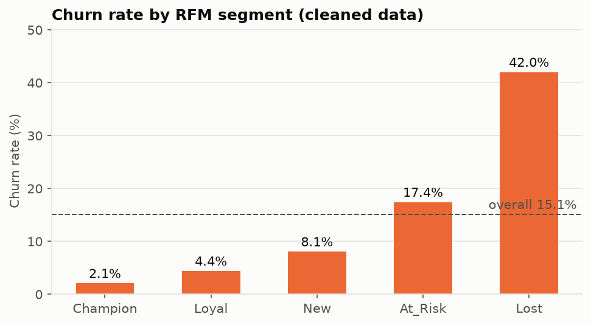

Churn rises from 2.1% to 42.0% as the segment gets worse. Lost customers churn at 2.8 times the overall 15.1%, and At_Risk and Lost together hold 84.4% of all churners (634 of 751). The segments now carry information, which HCL's labels did not.

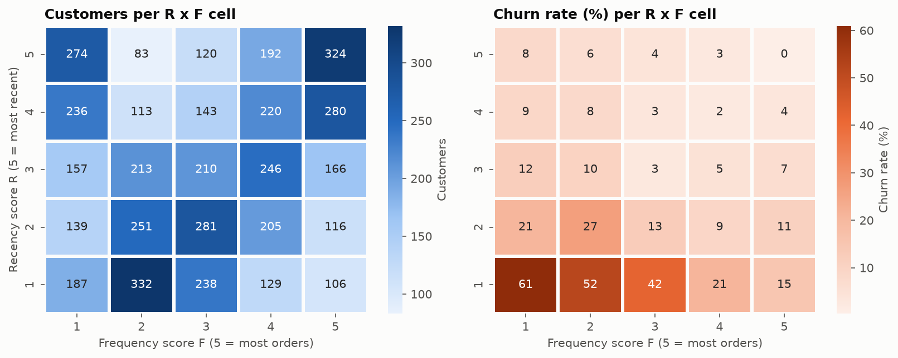

Churn by recency score falls from 43.2% (R = 1) to 16.5%, 7.1%, 5.0% and 3.8% (R = 5). The worst cell is R = 1, F = 1 at 61%.

### 7.3 Agreement with the app

The first version of the app scored quintiles with a simpler integer formula. A comparison against pandas found that the two could put one customer on the other side of a cut-off for some row counts (90 of the 151 possible counts between 4,850 and 5,000). The app was changed to use the same rule as `pandas.qcut` on ranks: rank r goes to the first score k whose upper edge 1 + (n − 1)·k/5 is at least r. After the change, the two were compared for every row count from 5 to 399 and from 4,800 to 5,100 (696 sizes) with 0 differences, and on the delivered file the app's computed segment equals the `rfm_segment` column for 4,961 of 4,961 customers (shown on the Segments page).

---

## 8. Churn prediction model

### 8.1 Features and target

The target is churn_flag. The features are the four numeric columns (purchase_freq, avg_order_value, last_purchase_days, loyalty_points) standardised to mean 0 and standard deviation 1, plus one-hot encodings of age_group (5 categories) and region (5 categories). rfm_segment is **not** a feature. It is computed from recency and frequency, which are already features, so including it would leak information the model gets anyway and make the explanation of the model unclear.

### 8.2 Method

- Stratified 80/20 split, seed 42: 3,968 training rows and 993 test rows. Both have a churn rate of about 15.1% (150 churners in the test set).
- **Logistic regression** with `class_weight="balanced"` and the default L2 penalty (C = 1). Class weighting counters the imbalance: with 85% non-churners an unweighted model would rarely predict churn.
- **Random forest** with 300 trees, a minimum of 5 samples per leaf and balanced class weights, as a comparison.
- Decision threshold 0.5 on the predicted probability.
- Scaling statistics are computed on the training rows only.

### 8.3 Results on the 993 test rows

| Model | Accuracy | Precision | Recall | F1 | ROC-AUC |
|---|---:|---:|---:|---:|---:|
| Logistic regression (exported) | 0.7593 | 0.3560 | 0.7333 | 0.4793 | 0.8133 |
| Random forest | 0.8107 | 0.4069 | 0.5533 | 0.4689 | 0.7942 |
| "Nobody churns" baseline | 0.8489 | 0 | 0 | 0 | 0.5 |

Confusion matrix of the logistic regression (rows are the actual class): 644 correct non-churners and 199 non-churners wrongly flagged; 40 missed churners and 110 correctly flagged.

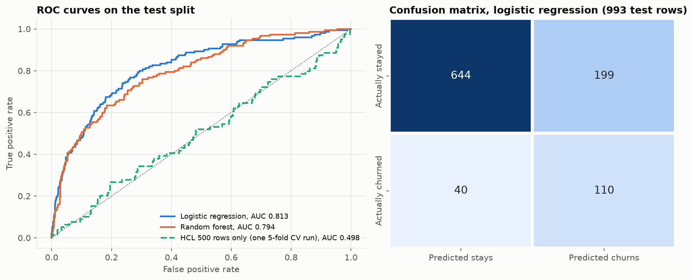

**Reading the numbers.**

- The "nobody churns" baseline scores the highest accuracy (0.849) while being useless. For an imbalanced target, accuracy alone misleads, and that is why precision, recall, F1 and ROC-AUC are reported.
- The logistic regression finds 110 of 150 churners (recall 73.3%) but flags 199 loyal customers too, so only about one flag in three (precision 35.6%) is a real churner. In campaign terms, for every customer correctly flagged, about two others receive an offer they did not need. That is acceptable for a discount email and not for an expensive phone call. The threshold can be moved in the model file to trade precision for recall.
- The random forest has higher accuracy and precision but lower recall and a lower ROC-AUC, and cannot be exported as a single line of arithmetic. The logistic regression ranks customers better here, is exact in a browser, and can show each customer's reasons. Those are the reasons it is the exported model.
- Five-fold cross-validation on the training rows gives ROC-AUC 0.817 with a standard deviation of 0.005, close to the test value, so the result is not a lucky split.
- The same model type, trained on the 4,461 generated rows alone, reaches a cross-validated ROC-AUC of 0.847. The 500 random rows (10% of the data) pull the combined score down to 0.813. This is the cost of keeping HCL's rows in the file.

**Calibration note.** Class weighting pushes predicted probabilities above the real 15% churn rate. The app should show the value as a risk score for ranking customers and for the 0.5 flag, not as a literal probability of leaving.

### 8.4 What drives churn

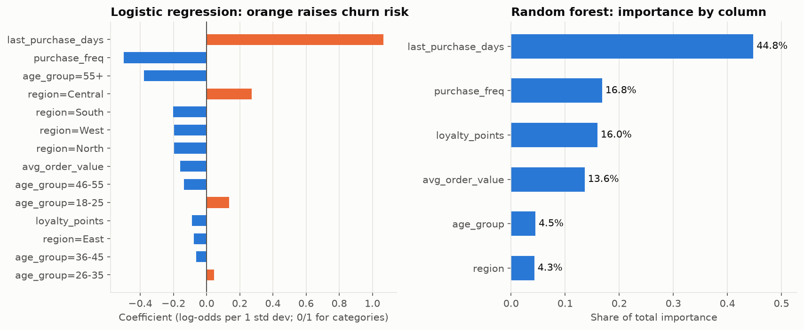

| Feature | LR coefficient (per standard deviation) | RF importance |
|---|---:|---:|
| last_purchase_days | +1.067 | 44.8% |
| purchase_freq | -0.500 | 16.8% |
| loyalty_points | -0.087 | 16.0% |
| avg_order_value | -0.158 | 13.6% |
| age_group (all categories) | 55+: -0.378; 18-25: +0.135 | 4.5% |
| region (all categories) | Central: +0.273; South: -0.201 | 4.3% |

Recency dominates in both models; one standard deviation is about 108 days. Frequency is second. Loyalty points, order value and frequency overlap (monetary value is frequency times order value and points follow spend), so the regression splits credit among them and a single coefficient should not be read as an independent effect. These patterns match the way the data was generated, which is the expected result of a correct pipeline on synthetic data.

### 8.5 Export format and self-check

The model is saved as `src/data/churn-model.json`: the standardisation mean and standard deviation for each numeric column, the category lists, one coefficient per numeric column and per category (all five age groups and all five regions, none dropped), the intercept, the 0.5 threshold, the metrics, the comparison table, the AUC on HCL's 500 rows, the importance list and a timestamp. The app computes

```
z = intercept + sum over numeric columns of coef * (x - mean) / std + sum over category columns of coef (1 if the customer has that category, else 0)
p = 1 / (1 + e^(-z))
```

The training script ends with a self-check. It reloads the JSON file, scores five sampled test rows in plain Python with `math.exp` (no numpy and no scikit-learn) and asserts the result matches scikit-learn's `predict_proba` to within 1e-6. It also checks every one of the 993 test rows: the largest difference found is 2.2e-16.

---

## 9. System architecture

### 9.1 Data flow diagram, level 0

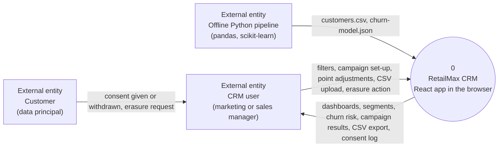

The customer never uses the app directly. A staff member records the customer's consent or erasure request, which is the realistic arrangement for a store or call-centre setting.

### 9.2 Data flow diagram, level 1

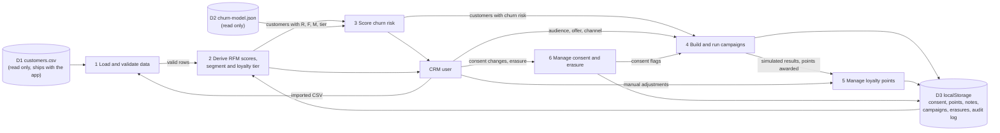

### 9.3 Block diagram

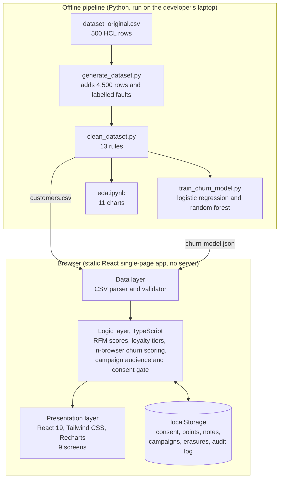

### 9.4 Layers

| Layer | Technology | Responsibility |
|---|---|---|
| Presentation | React 19, TypeScript, Vite, Tailwind CSS, Recharts | Nine screens, charts, forms, tables |
| Logic | TypeScript, in the browser | RFM quintile scores and segments, loyalty tiers, churn scoring from the model JSON, campaign audience and consent gate, CSV validation |
| Data | CSV file shipped with the app, browser localStorage | Customer rows (read only), user changes (saved per browser) |
| Offline pipeline | Python 3.13, pandas, NumPy, scikit-learn, matplotlib, seaborn, Jupyter | Dataset preparation, cleaning, model training, EDA |

There is no server-side database. This is deliberate and is stated in the synopsis: customer data is a CSV and state lives in localStorage, so nothing leaves the user's browser.

### 9.5 Why the model is exported as JSON

A logistic regression is a weighted sum passed through a sigmoid. Exporting its numbers means the app needs no Python, no server and no machine-learning library. Scoring all 4,961 customers is plain arithmetic in the browser. The same arithmetic is checked against scikit-learn by the training script. Retraining on new data means running one script and replacing one file.

---

## 10. Module descriptions

The app has nine screens, listed in the navigation in four groups. Descriptions below follow what the code does; learner screenshots should be added where marked.

| # | Module | What it does |
|---|---|---|
| 1 | **Dashboard** | Headline figures computed from the loaded customers (customer count, churn rate, segment and risk mix) with charts. This is the first screen. |
| 2 | **Customers and 360 view** | A searchable, filterable customer list and a profile page per customer: RFM scores, segment, loyalty tier, marketing consent, churn risk with the contribution of each feature to the score, notes, a points adjustment dialog and a suggested next action. |
| 3 | **RFM Segments** | Explains the rule, shows segment sizes, value and churn, and an R by F heatmap. The cards show what each segment is and what to do with it. |
| 4 | **Churn Prediction** | Risk bands (Low, Medium, High) from the model, a model card with the metrics from `churn-model.json`, an at-risk customer table and a what-if view. High means the probability is at or above the model threshold (0.5); Medium is 60% of the threshold or more. |
| 5 | **Campaigns** | A wizard to pick channel (Email, SMS, WhatsApp, Push), audience (segments, regions, age groups, risk bands), offer, discount and points multiplier. The audience is counted twice: everyone who matches, and those who consented. Only the consented customers are contacted. Results (sent, delivered, opened, clicked, converted, revenue) are **simulated** from fixed channel and segment rates, and the screen says so. A campaign with no consented customers is not sent. |
| 6 | **Loyalty** | Tiers Bronze (from 0 points), Silver (2,500), Gold (5,000) and Platinum (8,000). Earning rule: 1 point per INR 100 spent. Point value for the liability figure: INR 0.25. Members per tier, customers close to the next tier, a ledger of every adjustment and a bulk award to a segment or tier. In the cleaned data 71.0% of customers are Bronze, 18.9% Silver, 7.5% Gold and 2.6% Platinum. |
| 7 | **Sales Funnel** | Because the dataset records purchases and not visits or leads, the funnel follows the customer lifecycle: all customers, repeat buyers (2 or more orders), regular (6 or more), frequent (12 or more), high value (top 25% by spend) and retained (not churned). Each stage keeps only customers who passed the stages before it. A second funnel follows a campaign from sent to delivered, opened, clicked and converted. |
| 8 | **Data Import / Export** | Upload a CSV with the same nine columns; rows are validated and errors are listed before anything is imported. Export the full customer table as CSV. A data quality panel summarises the file. |
| 9 | **Privacy and Consent** | The consent log (who, granted or withdrawn, source, time), the right-to-erasure action, and an audit trail of important actions. |

*[FILL IN: add one screenshot per module here for the final submission.]*

Two points a reader should know. First, the HCL dataset has no consent column, so the app starts from a **demo default**: about 78% of customers are treated as opted in, decided by a hash of the customer id so it is stable between reloads. Any change the user makes is saved and overrides the default. A real deployment must replace this with recorded consent. Second, the app reads `rfm_segment` from the CSV but displays the segment it computes itself with the shared rule; the two agree on every row of the delivered file.

---

## 11. Testing approach

Testing has two parts: checks on the data pipeline, which were run and whose results are recorded here, and checks on the application screens, which are designed here for the learner to run and record.

### 11.1 Data pipeline checks (run)

| # | Check | Result |
|---|---|---|
| T1 | `data/dataset.csv` header equals HCL's header exactly | pass |
| T2 | Row count between 4,850 and 5,000 | pass: 4,961 |
| T3 | Churn rate between 13% and 17% | pass: 15.14% |
| T4 | No nulls; unique customer_id; all values inside the valid ranges | pass (asserted inside `clean_dataset.py`) |
| T5 | `src/data/customers.csv` byte-identical to `data/dataset.csv` | pass |
| T6 | Generator and cleaner are deterministic: two runs give identical files | pass |
| T7 | Cleaning rules caught the injected faults | pass: 135 of 135 labelled faults handled by the expected rule |
| T8 | JSON model reproduces scikit-learn's probabilities to 1e-6 | pass: largest difference 2.2e-16 over all 993 test rows |
| T9 | App quintile formula equals pandas `qcut` on ranks | pass: 0 differences over 696 row counts; 4,961 of 4,961 segments agree in the app |
| T10 | EDA notebook runs top to bottom with saved outputs | pass: 14 of 14 code cells, 11 charts, no errors |
| T11 | Signal test on HCL's 500 rows | recorded: model ROC-AUC 0.475, given labels match the RFM rule on 19.4% |

### 11.2 Model evaluation

The model is evaluated on a stratified hold-out set that no step of training touched (993 rows), with five-fold cross-validation on the training rows as a second view (ROC-AUC 0.817, standard deviation 0.005). Scaling statistics come from the training rows only. Random seeds are fixed so every number in this report can be reproduced.

### 11.3 Application test cases (to be run by the learner)

| # | Screen | Action | Expected result | Status |
|---|---|---|---|---|
| A1 | Dashboard | Open the app | Customer count equals 4,961 and churn rate 15.1% | [FILL IN] |
| A2 | Customers | Search for C00001 and open the profile | RFM scores, segment, tier, churn risk and consent shown | [FILL IN] |
| A3 | Customers | Switch consent off for a customer, reload the page | The change is still there (saved in localStorage) | [FILL IN] |
| A4 | Campaigns | Build a campaign for the Lost segment and launch it | Audience size shown before and after the consent gate; only the consented count is contacted | [FILL IN] |
| A5 | Campaigns | Launch a campaign to an audience where nobody has consent | The campaign is not sent and the user is told why | [FILL IN] |
| A6 | Loyalty | Add 500 points to a customer | Balance rises by 500, tier updates if a threshold is crossed, the ledger shows the entry | [FILL IN] |
| A7 | Churn Prediction | Open a High-risk customer | Risk is at or above 0.5 and the per-feature contributions are listed | [FILL IN] |
| A8 | Data Import | Upload a CSV with a wrong header | Import is refused with an error message | [FILL IN] |
| A9 | Data Import | Upload a CSV with some bad rows | Errors are listed and valid rows can be imported | [FILL IN] |
| A10 | Data Export | Export the full table and open it | Same nine columns in the same order | [FILL IN] |
| A11 | Privacy | Erase a customer | The customer disappears from every screen and the audit trail records the action | [FILL IN] |
| A12 | All | Run `npm run build` | TypeScript compiles with no errors | [FILL IN] |

The app was not load-tested and its response time was not measured, so this report gives no performance figure for it.

---

## 12. Results

### 12.1 Dataset

| Item | Value |
|---|---|
| Raw rows | 5,020 (500 HCL, 4,500 generated, 20 duplicates) |
| Cleaned rows | 4,961 (500 HCL, 4,461 generated) |
| Columns | 9, same names and order as HCL's file |
| Faults labelled | 135 (2.7% of 5,000 rows) |
| Churn rate | 15.14% (751 of 4,961) |
| Segments | At_Risk 1,445, Champion 1,016, Lost 909, Loyal 885, New 706 |
| Loyalty tiers | Bronze 3,522, Silver 938, Gold 371, Platinum 130 |

### 12.2 Churn model

| Metric | Logistic regression | Random forest |
|---|---:|---:|
| Accuracy | 0.759 | 0.811 |
| Precision | 0.356 | 0.407 |
| Recall | 0.733 | 0.553 |
| F1 | 0.479 | 0.469 |
| ROC-AUC | 0.813 | 0.794 |

On HCL's 500 rows alone the same model type scores a ROC-AUC of 0.475 (repeated cross-validation), 0.519 when the exported model scores the 91 original rows in its test split, and 0.492 when a model learned from generated rows only scores all 500 original rows. All three sit around 0.5.

### 12.3 What the numbers mean for the business

- At_Risk and Lost customers are 47.5% of the customer base and hold 84.4% of churners. A win-back campaign aimed at those two segments reaches most people who leave.
- Recency is the strongest warning sign: churn is 4.7% for customers who bought in the last 90 days and 46.2% for those silent for more than 270 days.
- The consent gate means a campaign's reach is smaller than its audience. This is by design.
- A flag list from the model is 35.6% precise, so campaigns using it should be cheap (an email or a points bonus), and a manager should expect that about two in three recipients would have stayed anyway.

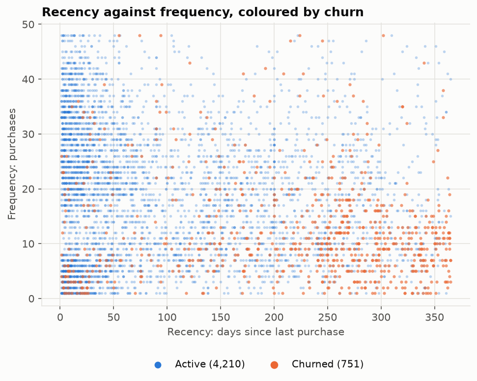

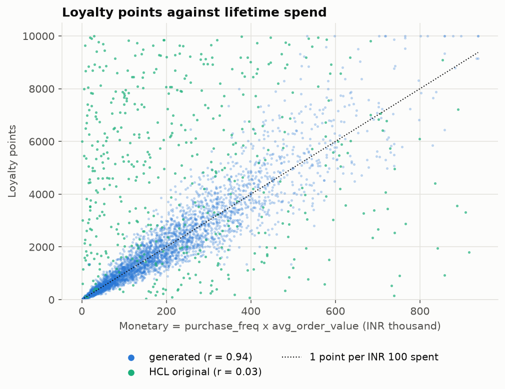

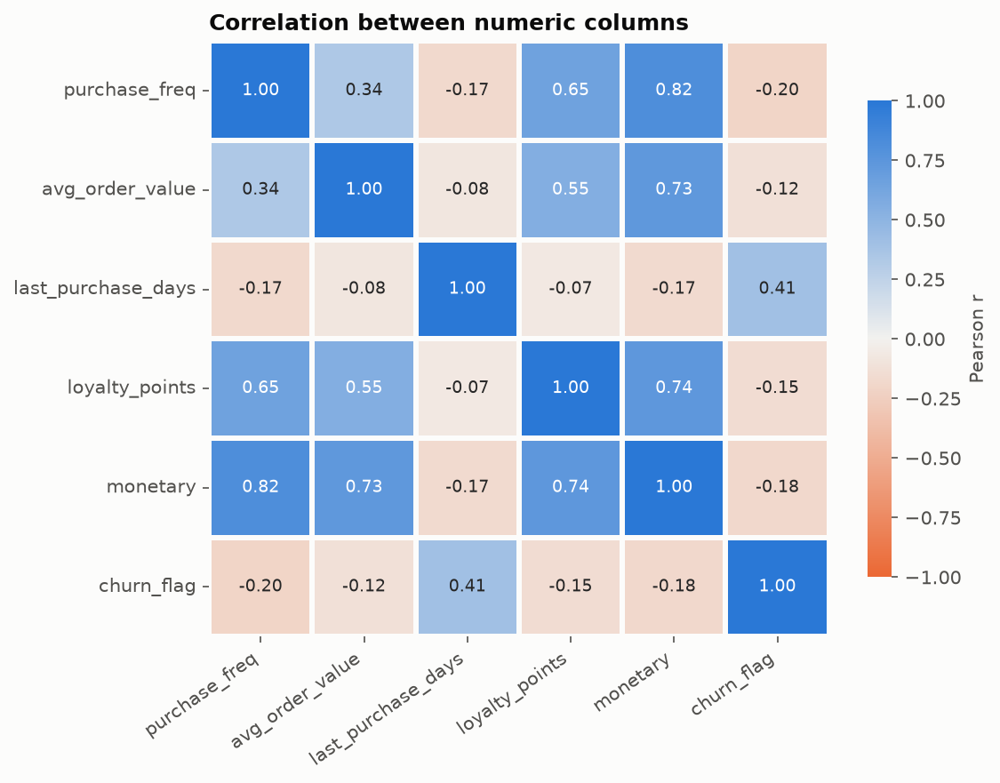

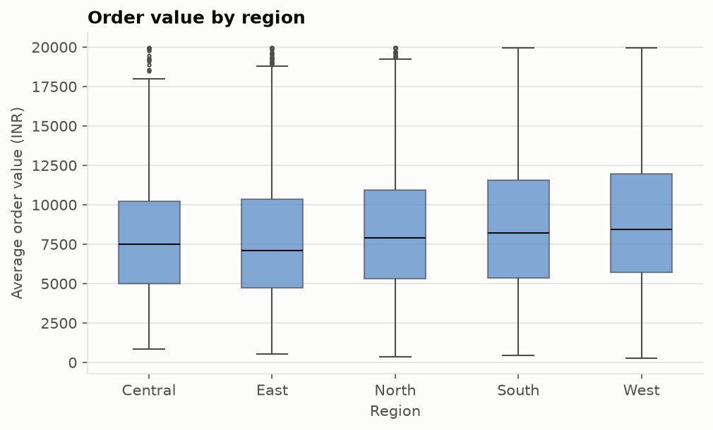

---

## 13. Challenges and resolutions

| # | Challenge | Resolution |
|---|---|---|
| 1 | HCL's 500 rows carry no signal: churn and recency are flat across segments, and the labels match the RFM rule only at chance level. | Measured it (five tests in section 5.2), reported it, and followed HCL's own allowance to generate extra rows with realistic patterns. HCL's rows stay in the file, and the report says results come from the generated patterns. |
| 2 | The given segment labels contradict the RFM definition. | Recomputed the segment with the shared rule, so the CSV and the app show the same value. The original labels remain in `data/dataset_original.csv`. |
| 3 | Churn is imbalanced (15%), so accuracy looks good for a useless model (0.849 for "nobody churns"). | Reported precision, recall, F1 and ROC-AUC next to accuracy, used class weights, and compared with a baseline. |
| 4 | The model had to run in a browser with no server. | Chose logistic regression, exported its numbers as JSON and wrote a self-check that scores from the JSON file in plain Python and compares to scikit-learn to 1e-6. |
| 5 | The segment rule exists twice (Python and TypeScript) and could drift. | Used pandas `qcut` on `rank(method="first")` to match the app's tie-breaking, then compared the two on the delivered file (0 differences). Found that the two could differ by one customer for some row counts, then changed the app to the exact pandas rule; 0 differences over 696 row counts. |
| 6 | Cleaning could quietly invent data. | Never impute the label or recency and frequency; drop out-of-range rows instead of clipping; document each rule with a count; check the rules against the injected fault labels. |
| 7 | The dataset has no consent column, but the brief requires consent before marketing. | The app keeps its own consent flags and log. It starts from a documented demo default and the user's changes override it. |
| 8 | The dataset records purchases, not visits or leads, so a classic sales funnel is impossible. | Built a lifecycle funnel from purchase counts and spend, and a campaign funnel from sent to converted. |
| 9 | Keeping the random rows costs model quality (0.813 against 0.847 on generated rows alone). | Kept them and said so, because removing HCL's data would remove the supplied file from the submission. |

---

## 14. Ethics and DPDP Act 2023 compliance

HCL's brief requires three things: customer data must be anonymised, consent must be obtained before purchase history is used for marketing, and the project must comply with the DPDP Act 2023.

### 14.1 Anonymisation

- The data holds no names, phone numbers, email addresses or street addresses. The only identifier is customer_id, a key such as C00001. Age is an age band and location is one of five regions.
- The rows are synthetic or supplied by HCL as an anonymised teaching file. No real person's data was collected for this project.
- Age band and region together could single out a person in a small group. The smallest age-band by region group in the delivered file has 76 customers, so no combination identifies a small handful of people.
- The customer_id is pseudonymous: in a real deployment, the mapping from id to a real person would stay in the retailer's source system and never enter this dataset or the app.

### 14.2 Consent before marketing

- A customer's marketing consent is stored per customer. The campaign builder counts everyone who matches an audience and, separately, everyone who matches **and** consented. Only the second group is contacted. A campaign whose audience has no consent is not sent.
- Consent can be granted or withdrawn on the customer's profile and on the Privacy and Consent screen. Each change is written to a consent log with the customer id, granted or withdrawn, the source and the time.
- Withdrawing consent takes the same single action as granting it, in line with the Act's expectation that withdrawal is as easy as giving consent.
- Limit: the demo starts from a hash-based default (about 78% opted in) because the dataset has no consent field. That default is a stand-in and must not be used with real customers.

### 14.3 Rights and retention

- **Right to erasure.** The erase action removes the customer from the data in use and records an audit event. Erasure is stored in localStorage, so it applies to that browser's copy. Erasure from a real source system is outside this prototype.
- **Access.** The customer's profile and the full CSV export let staff produce a customer's record on request.
- **Data stays on the device.** The app has no server, makes no network calls to send customer data, and keeps state in the browser only. Clearing the site data resets it.
- **Children.** The youngest age band is 18-25, so the dataset holds no data on minors.

### 14.4 What this prototype does not do

A real system would also need a privacy notice shown before consent is asked, consent records stored on a server with tamper evidence, role-based access, encryption at rest, breach handling and a grievance contact. Those are noted in section 15. *[FILL IN: learner to confirm the current commencement status of the Act's Rules before submission and cite the official Gazette notification.]*

### 14.5 Licence and AI disclosure

HCL's dataset is used under the terms of the programme folder it came in. The generated rows are original to this project. AI tools used for code and writing are disclosed in Appendix A, as the synopsis declaration requires.

---

## 15. Limitations and future scope

### 15.1 Limitations

1. **Synthetic patterns.** 90% of the rows were generated with churn rules chosen by the author, so the model's metrics show the pipeline works. They are not evidence of how well churn can be predicted at a real retailer.
2. **Small, shallow history.** One row per customer with six behavioural fields. There is no purchase-by-purchase history, product data, returns or channel data.
3. **Threshold and probabilities.** The 0.5 threshold with balanced weights gives high recall and low precision, and the probabilities are inflated relative to the true rate.
4. **Simulated campaigns.** Campaign results come from fixed channel and segment rates. No message is sent and no response is measured.
5. **Browser-only state.** One browser holds one copy of the changes. There are no user accounts, no sharing, no backup and no server-side audit trail.
6. **One rule, two languages.** The segment rule is written in Python and in TypeScript. They match today (checked over 696 row counts); a shared test fixture would keep them matched after future edits.
7. **Range checks only.** Cleaning cannot find wrong values that look plausible.

### 15.2 Future scope

- Replace the CSV with a PostgreSQL database behind a REST API (the brief's suggested stack), with user accounts and roles.
- Train on real transaction history with time-based splits, so the model is tested on the future and not on a random sample.
- Add survival or time-to-churn modelling, and calibrate the probabilities.
- Send real campaigns through an email or WhatsApp provider, record opens and conversions, and measure uplift with a control group.
- Store consent on a server with a version of the privacy notice, expiry dates and a consent receipt.
- Add a scheduled retraining job and a drift check on the model's inputs.
- Add product-level data for recommendations and basket analysis.

---

## 16. References

1. Hughes, A. M. (1994). *Strategic Database Marketing: The Masterplan for Starting and Managing a Profitable, Customer-Based Marketing Program.* Probus Publishing, Chicago.
2. Fader, P. S., Hardie, B. G. S., & Lee, K. L. (2005). RFM and CLV: Using iso-value curves for customer base analysis. *Journal of Marketing Research*, 42(4), 415-430.
3. Chen, D., Sain, S. L., & Guo, K. (2012). Data mining for the online retail industry: A case study of RFM model-based customer segmentation using data mining. *Journal of Database Marketing & Customer Strategy Management*, 19(3), 197-208.
4. Neslin, S. A., Gupta, S., Kamakura, W., Lu, J., & Mason, C. H. (2006). Defection detection: Measuring and understanding the predictive accuracy of customer churn models. *Journal of Marketing Research*, 43(2), 204-211.
5. Verbeke, W., Martens, D., Mues, C., & Baesens, B. (2011). Building comprehensible customer churn prediction models with advanced rule induction techniques. *Expert Systems with Applications*, 38(3), 2354-2364.
6. Reichheld, F. F., & Sasser, W. E. (1990). Zero defections: Quality comes to services. *Harvard Business Review*, 68(5), 105-111.
7. He, H., & Garcia, E. A. (2009). Learning from imbalanced data. *IEEE Transactions on Knowledge and Data Engineering*, 21(9), 1263-1284.
8. Hosmer, D. W., Lemeshow, S., & Sturdivant, R. X. (2013). *Applied Logistic Regression* (3rd ed.). Wiley.
9. Breiman, L. (2001). Random forests. *Machine Learning*, 45(1), 5-32.
10. Fawcett, T. (2006). An introduction to ROC analysis. *Pattern Recognition Letters*, 27(8), 861-874.
11. Pedregosa, F., et al. (2011). Scikit-learn: Machine learning in Python. *Journal of Machine Learning Research*, 12, 2825-2830.
12. McKinney, W. (2010). Data structures for statistical computing in Python. *Proceedings of the 9th Python in Science Conference*, 56-61.
13. Kumar, V., & Reinartz, W. (2018). *Customer Relationship Management: Concept, Strategy, and Tools* (3rd ed.). Springer.
14. Government of India. *The Digital Personal Data Protection Act, 2023* (Act No. 22 of 2023).
15. Salesforce, Inc. *Sales Cloud* product documentation; HubSpot, Inc. *HubSpot CRM* product documentation (feature comparison in section 4.3; consult the vendors' current documentation pages).
16. HCLTech Career Shaper Programme. *Project Brief, Project No. 27* and *Project Synopsis Template*, Academic Year 2025-26 (provided by the Programme Coordinator).

*[FILL IN: mentor to validate and add links, as the brief's References section asks.]*

---

## Appendix A: AI tools disclosure

This project was built with AI assistance. The AI tool used was **Claude** (Anthropic), working as a coding assistant. It was used to:

- write and run the Python pipeline (`generate_dataset.py`, `clean_dataset.py`, `train_churn_model.py`) and the EDA notebook;
- write the React and TypeScript application with a separate assistant session;
- draft this report, the synopsis and the README, using numbers produced by the scripts.

Every number in this report comes from a script run on this project's files. The learner is responsible for understanding the code and results and for explaining them at the expo.

*[FILL IN: learner to describe what they reviewed, ran and changed themselves.]*

---

## Appendix B: How to rerun the pipeline

From the project root (full details in `analysis/README.md`):

```bash
python -m venv .venv
.venv/Scripts/python -m pip install -r analysis/requirements.txt

.venv/Scripts/python analysis/generate_dataset.py
.venv/Scripts/python analysis/clean_dataset.py
.venv/Scripts/python analysis/train_churn_model.py
.venv/Scripts/python -m jupyter nbconvert --to notebook --execute --inplace analysis/eda.ipynb
```

| File | Role |
|---|---|
| `data/dataset_original.csv` | HCL's 500 rows (never edited) |
| `data/dataset_raw_combined.csv` | 500 original + 4,500 generated rows + injected faults |
| `data/anomaly_labels.csv` | Ground truth for the injected faults |
| `data/dataset.csv` | Cleaned deliverable, 4,961 rows |
| `data/cleaning_report.md` | Rows in and out, per-rule counts |
| `data/data_dictionary.csv` | Described columns |
| `src/data/customers.csv` | Copy of `dataset.csv` for the app |
| `src/data/churn-model.json` | Exported model for the app |
| `analysis/eda.ipynb` | Executed EDA notebook |
| `docs/figures/` | Eleven chart PNGs |

---

## Appendix C: Deliverables checklist

| HCL deliverable | Status |
|---|---|
| Completed project (working prototype) | React app in `src/`; data science half in `analysis/` |
| Project report, minimum 8 pages | This document |
| EDA notebook with 3 or more visualisations | `analysis/eda.ipynb`, 11 visualisations, executed |
| `dataset.csv`, cleaned and pre-processed | `data/dataset.csv` |
| `data_dictionary.csv`, all columns described | `data/data_dictionary.csv` |
| Demo video (1 to 2 minutes) or live demo at expo | [FILL IN: learner to record] |
| Signed Ethical Compliance Declaration | [FILL IN: learner to sign the synopsis declaration] |
