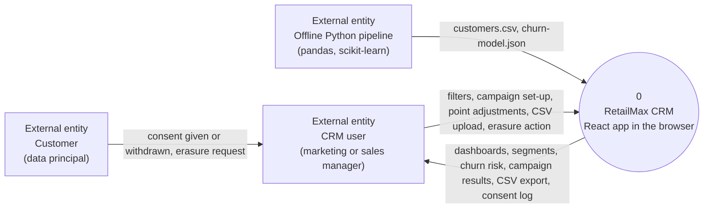
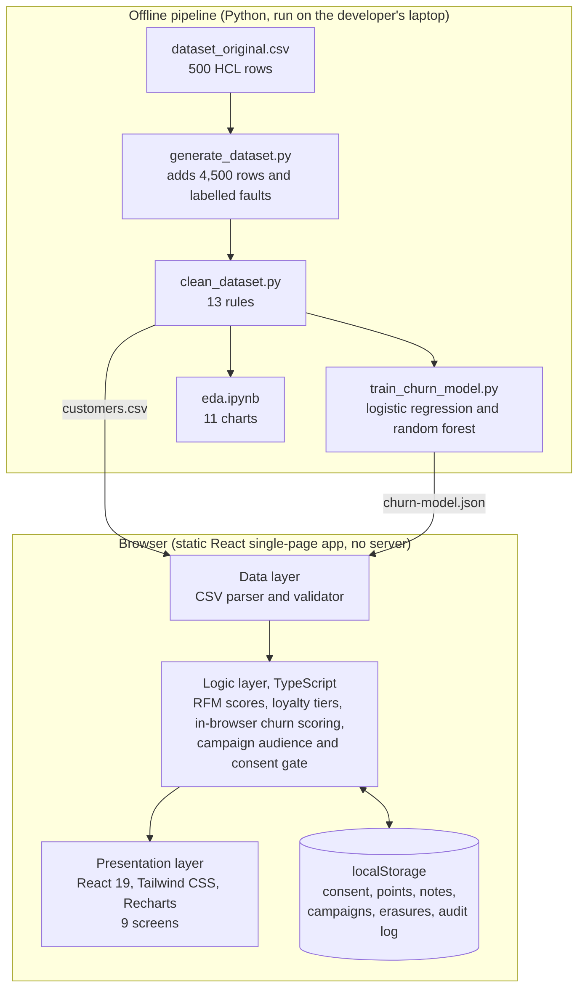

# Project Synopsis

**HCLTech Career Shaper Programme | III Year Industry Project | 2025-26**

| Field | Details |
|---|---|
| Project Title | RetailMax CRM: Streamlining Customer Relationships |
| Project No. | 27 |
| Domain | Digital-Data-AI / AIML |
| Difficulty | Intermediate |
| Duration | 4 Weeks |
| Format | Individual Project |
| Learner Name | [FILL IN] |
| Roll Number | [FILL IN] |
| College / Campus | [FILL IN] |
| Mentor Name | [FILL IN] |
| Submission Date | [FILL IN] |

## 1. Problem Statement

**Who:** marketing and sales managers at a retail business with customers in several regions. **What:** customers are kept in spreadsheets and treated alike, so nobody can see who is valuable, who is drifting away, or who has agreed to receive marketing; loyalty points are tracked by hand and churn is noticed only after the customer has gone. **When / where:** in every campaign cycle and every region, because retail churn is silent (the customer just stops buying). **Why it matters:** keeping a customer costs less than winning a new one, and marketing without consent is a legal risk under India's Digital Personal Data Protection Act 2023. **How:** group customers with RFM (recency, frequency, monetary value), estimate each customer's churn risk with a machine learning model, and let the team run campaigns that reach only customers who gave consent.

## 2. Proposed Solution and Approach

RetailMax CRM is a React 19 and TypeScript web app with nine screens: Dashboard, Customers with a 360-degree profile, RFM Segments, Churn Prediction, Campaigns, Loyalty, Sales Funnel, Data Import and Export, and Privacy and Consent. A separate offline Python pipeline (pandas and scikit-learn) cleans the data, trains a logistic regression churn model and exports it as a small JSON file, which the app evaluates in the browser. Segments follow one RFM rule shared by the Python code and the app. The campaign builder counts the audience before and after a consent check and contacts only consented customers. The app has no server database: customer data is a CSV file and the user's changes are saved in the browser's localStorage.

## 3. System Architecture

Data flow diagram, level 0:

System block diagram:

*[FILL IN: paste a rendered image of both diagrams here if the submission must be a document. The full architecture with a level 1 diagram is in `docs/PROJECT_REPORT.md`, section 9.]*

## 4. Technology Stack

| Layer | Technology |
|---|---|
| Frontend / UI | React 19, TypeScript, Vite, Tailwind CSS |
| Backend / Logic | In-browser TypeScript (RFM scoring, loyalty tiers, churn scoring from the model JSON, consent gate). There is no server. |
| Database | No server database. Data is a CSV file (`customers.csv`) read by the app, and the user's changes (consent, points, notes, campaigns) are saved in browser localStorage. |
| AI/ML Framework | Python 3.13 with pandas, NumPy and scikit-learn (offline pipeline); logistic regression and random forest; the logistic regression is exported as JSON |
| Visualisation | Recharts (in the app); matplotlib and seaborn (EDA notebook) |
| Hardware | None. A laptop with a modern web browser. |

## 5. Dataset Used

| Item | Details |
|---|---|
| Dataset file name | `dataset.csv` (cleaned, in `data/`); HCL's original `dataset_original.csv` has 500 rows |
| Number of rows | 4,961 (500 HCL rows and 4,461 generated rows, after cleaning 5,020 raw rows) |
| Number of columns | 9 |
| Key columns | `purchase_freq`, `avg_order_value`, `last_purchase_days`, `loyalty_points`, `churn_flag` (also `customer_id`, `age_group`, `region`, `rfm_segment`) |
| Any additional data collected | 4,500 synthetic CRM rows generated with a Python script, as HCL's brief allows. No real customer data was collected. |

HCL's 500 rows are statistically random (churn is 13.7% to 20.0% in every given segment, and a model trained on them alone has ROC-AUC 0.475), so the generated rows are what carry the patterns a churn model can learn. The report explains this in section 5.

## 6. Key Results and Metrics

All figures are from the 993-row held-out test set (stratified 80/20 split, seed 42).

- **Metric 1: Model ROC-AUC (logistic regression):** 0.813. The random forest comparison model scores 0.794.
- **Metric 2: Recall / precision at threshold 0.5:** recall 0.733 (110 of 150 churners found), precision 0.356.
- **Metric 3: Accuracy and F1:** accuracy 0.759, F1 0.479. A model that predicts "nobody churns" gets accuracy 0.849, so accuracy alone is not used to judge the model.
- Response time of the app: not measured.
- **Business value achieved:** the At_Risk and Lost segments are 47.5% of customers and hold 84.4% of churners, so a win-back campaign aimed at them reaches most people who leave. Campaigns contact only customers with consent. These results come from patterns built into the generated data and show that the pipeline works; they are not a claim about a real retailer.

## 7. Challenges Faced and How Resolved

- **Challenge 1:** HCL's 500 rows carry no signal: churn and recency are the same in every segment, and the given segment labels match the RFM rule on 19.4% of rows (chance level). **Resolution:** measured and reported it, generated 4,500 rows with realistic correlated patterns (allowed by HCL's brief), recomputed segments with the shared rule, and kept HCL's rows in the file.
- **Challenge 2:** Churn is imbalanced (about 15%), so accuracy looks good for a useless model. **Resolution:** used balanced class weights, reported precision, recall, F1 and ROC-AUC, and compared with a "nobody churns" baseline.
- **Challenge 3:** The model had to run in a browser with no server. **Resolution:** chose logistic regression, exported its numbers as JSON, and added a self-check that scores from the JSON file in plain Python and matches scikit-learn to within 1e-6.

## 8. References

1. Hughes, A. M. (1994). *Strategic Database Marketing.* Probus Publishing, Chicago.
2. Fader, P. S., Hardie, B. G. S., & Lee, K. L. (2005). RFM and CLV: Using iso-value curves for customer base analysis. *Journal of Marketing Research*, 42(4), 415-430.
3. Neslin, S. A., Gupta, S., Kamakura, W., Lu, J., & Mason, C. H. (2006). Defection detection: Measuring and understanding the predictive accuracy of customer churn models. *Journal of Marketing Research*, 43(2), 204-211.
4. Pedregosa, F., et al. (2011). Scikit-learn: Machine learning in Python. *Journal of Machine Learning Research*, 12, 2825-2830.
5. Government of India. *The Digital Personal Data Protection Act, 2023* (Act No. 22 of 2023).

*[FILL IN: mentor to validate and add links.]*

## 9. Ethical Compliance Declaration

I confirm that:

- ☐ All dataset usage complies with the source licence.
- ☐ No personally identifiable information (PII) is stored without consent.
- ☐ AI tools used for code/writing are disclosed in the Appendix. *(Disclosure: this project was built with AI assistance, Claude by Anthropic; see Appendix A of the project report.)*
- ☐ This project complies with the DPDP Act 2023 where applicable.

Learner Signature: _________________________    Date: ________________

*The learner ticks the boxes and signs. The declaration is a personal statement and is left unticked on purpose.*

*Submit this file as 'Project_Synopsis_[YourName]_[RollNo].docx' | HCLTech Career Shaper Programme 2025-26*
